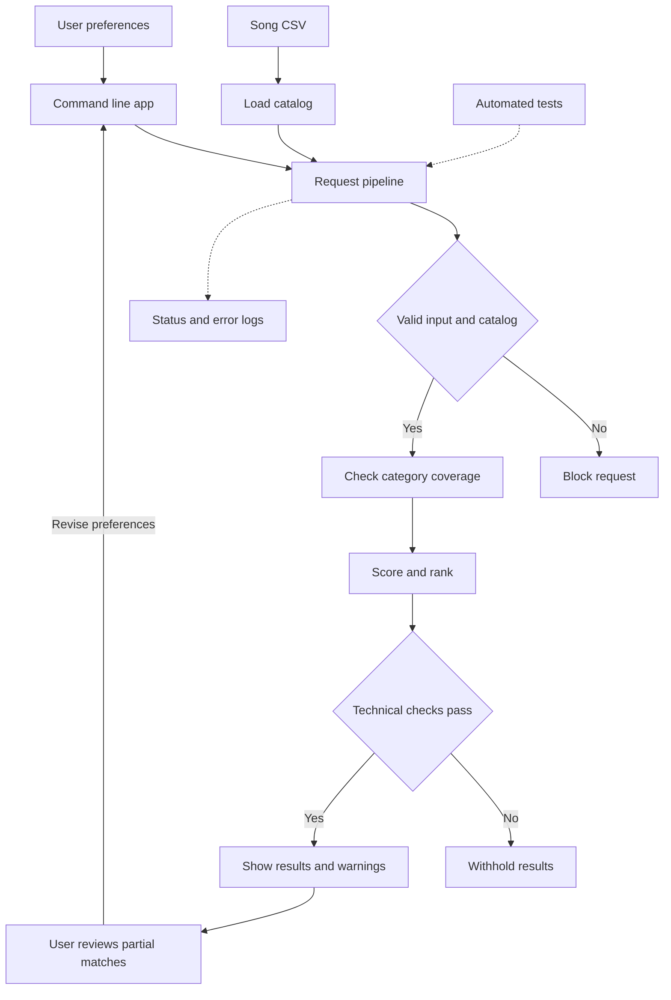

# VibeFinder: Applied AI System

## Summary and Base Project

This project extends my Module 3 Music Recommender Simulation, VibeFinder. The original project scored songs using genre, mood, and energy and returned explained top-five recommendations. It supported three taste profiles and a weight experiment.

Original repository:
https://github.com/Cameron-Batts/ai110-module3show-musicrecommendersimulation-starter

The applied system adds validated requests, catalog checks, coverage warnings, runtime output verification, logging, and automated reliability tests.

## Engineer's Pitch Summary

**Problem:** My Module 3 recommender always returned five songs, even for requests it could not match, such as opera in an 18-song catalog. I extended it so it checks its own input and output and says so when it cannot trust an answer.

**Logic:** Each request passes through five steps: validate the input, check catalog coverage, score and rank, verify the output, and show results with a status (`ok`, `needs_review`, `blocked`, or `verification_failed`). The system is rule-based with no LLM, and every song comes with a plain-language reason.

**Reliability:** 29 of 29 automated tests pass. They cover bad input, missing categories, broken catalogs, shared scoring weights, unexpected errors, and the CLI. One test injects a fake score of 99.0 and confirms the system withholds the results.

**Reflection:** A result can pass every technical check and still be useless, as the opera request showed. I renamed "Output verification: passed" to "Technical checks: passed" because the first wording overclaimed. After grading, I moved the scoring weights to one shared place and narrowed exception handling so real bugs surface.

## Integrated AI Feature: Reliability System

The selected advanced feature is a reliability and testing system integrated into the main recommendation application.

Every CLI request passes through src/system.py. Invalid preferences or catalog data block recommendations. Unknown genre or mood labels trigger needs_review warnings. Failed output checks withhold results.

The recommender remains a rule-based content-based system. It does not use an LLM, RAG, fine-tuning, or autonomous agent planning.

## Architecture Overview

The CLI loads the CSV and sends requests through validation, coverage checks, scoring, ranking, and output verification. Users can review partial matches and revise their preferences. Logging records request status and errors.

Required Mermaid source: [diagrams/architecture.mmd](diagrams/architecture.mmd)



## Setup

Requires Python 3.10 or newer. Run from the project root. No API key is needed.

```bash
python3 -m venv .venv
source .venv/bin/activate
python -m pip install -r requirements.txt
python -m src.main --demo
```

## Choosing Inputs

Not sure what to type? Run the built-in guide. Energy runs from 0 (calm) to 1 (intense), and genre and mood must match a label in the catalog to score points.

```bash
python -m src.main --guide
```
```text
Loaded songs: 18

Energy scale (0 = calm, 1 = intense). Bars show each song:
  0.16 ###                  Quiet Cathedral
  0.28 ######               Spacewalk Thoughts
  0.35 #######              Library Rain
  0.37 #######              Coffee Shop Stories
  0.40 ########             Focus Flow
  0.42 ########             Midnight Coding
  0.45 #########            Porchlight Home
  0.52 ##########           Island Afternoon
  0.75 ###############      Night Drive Loop
  0.76 ###############      Rooftop Lights
  0.79 ################     Midnight Verse
  0.82 ################     Sunrise City
  0.84 #################    Desert Pulse
  0.86 #################    Neon Heartbreak
  0.88 ##################   Brass Parade
  0.91 ##################   Storm Runner
  0.93 ###################  Gym Hero
  0.94 ###################  Electric Grief

Valid genres: afrobeat, ambient, classical, country, hip hop, indie pop, jazz, lofi, pop, reggae, rock, ska, synthwave
Valid moods: chill, confident, focused, happy, intense, joyful, moody, nostalgic, peaceful, playful, relaxed, sad

Example: python -m src.main --genre pop --mood happy --energy 0.8
```

## Design Decisions and Tradeoffs

The original scoring rule is retained: two points for genre, one for mood, and up to one for energy similarity. Separating scoring from validation keeps the changes understandable and preserves the original behavior for valid inputs.

Verification checks result count, catalog membership, unique IDs, finite and correct scores, descending order, and nonempty explanations. It does not prove that the returned subset is globally optimal or that explanation text accurately describes every contribution.

The scoring weights (`GENRE_WEIGHT`, `MOOD_WEIGHT`, `ENERGY_WEIGHT`) live in one place, `src/recommender.py`, and both the scorer and the verifier read them. A test changes a weight and confirms valid results are still accepted. The verifier still re-derives scores with the same formula, so it catches corrupted or inconsistent output but cannot catch a flaw in the formula itself.

Only two custom exceptions become statuses: `ValidationError` (bad input or catalog, status `blocked`) and `VerificationError` (bad output, status `verification_failed`). Any other exception is a real bug and is allowed to surface, which a test confirms. The request function is split into small steps (`validate_preferences`, `validate_catalog`, `check_coverage`, `verify_recommendations`) so each can be tested alone, and the CLI validates the catalog once at load time.

Unknown categories produce clearly labeled partial matches rather than silently pretending to match. Human review is advisory; no approval gate is enforced.

Logging goes to the terminal rather than a persistent file. The runtime uses Python's standard library; pytest is the only external test dependency. An optional GitHub Actions workflow runs the test suite on Python 3.10 and 3.12.

## Reproducible Execution Evidence

The following outputs were captured by executing these commands. Exit code 2 is expected for blocked single requests; successful and needs_review requests return 0.


### Normal pop request

```bash
python -m src.main --genre pop --mood happy --energy 0.8
```
```text
INFO: Request status=ok count=5
Loaded songs: 18

Input: {'genre': 'pop', 'mood': 'happy', 'energy': 0.8}
Status: ok
Technical checks: passed
1. Sunrise City | Score: 3.98
   Because: genre match (+2.00); mood match (+1.00); energy similarity (+0.98)
2. Neon Heartbreak | Score: 2.94
   Because: genre match (+2.00); energy similarity (+0.94)
3. Gym Hero | Score: 2.87
   Because: genre match (+2.00); energy similarity (+0.87)
4. Rooftop Lights | Score: 1.96
   Because: mood match (+1.00); energy similarity (+0.96)
5. Midnight Verse | Score: 0.99
   Because: energy similarity (+0.99)

Exit code: 0
```

### Normal lofi request

```bash
python -m src.main --genre lofi --mood chill --energy 0.35
```
```text
INFO: Request status=ok count=5
Loaded songs: 18

Input: {'genre': 'lofi', 'mood': 'chill', 'energy': 0.35}
Status: ok
Technical checks: passed
1. Library Rain | Score: 4.00
   Because: genre match (+2.00); mood match (+1.00); energy similarity (+1.00)
2. Midnight Coding | Score: 3.93
   Because: genre match (+2.00); mood match (+1.00); energy similarity (+0.93)
3. Focus Flow | Score: 2.95
   Because: genre match (+2.00); energy similarity (+0.95)
4. Spacewalk Thoughts | Score: 1.93
   Because: mood match (+1.00); energy similarity (+0.93)
5. Coffee Shop Stories | Score: 0.98
   Because: energy similarity (+0.98)

Exit code: 0
```

### Unavailable categories

```bash
python -m src.main --genre opera --mood dramatic --energy 0.5
```
```text
INFO: Request status=needs_review count=5
Loaded songs: 18

Input: {'genre': 'opera', 'mood': 'dramatic', 'energy': 0.5}
Status: needs_review
Technical checks: passed
WARNING: No catalog genre matches 'opera'.
WARNING: No catalog mood matches 'dramatic'.
Review these partial matches or revise your preferences.
1. Island Afternoon | Score: 0.98
   Because: energy similarity (+0.98)
2. Porchlight Home | Score: 0.95
   Because: energy similarity (+0.95)
3. Midnight Coding | Score: 0.92
   Because: energy similarity (+0.92)
4. Focus Flow | Score: 0.90
   Because: energy similarity (+0.90)
5. Coffee Shop Stories | Score: 0.87
   Because: energy similarity (+0.87)

Exit code: 0
```

### Invalid energy

```bash
python -m src.main --genre pop --mood happy --energy 1.5
```
```text
WARNING: Request blocked: energy must be a finite number between 0 and 1.
Loaded songs: 18

Input: {'genre': 'pop', 'mood': 'happy', 'energy': 1.5}
Status: blocked
ERROR: energy must be a finite number between 0 and 1.

Exit code: 2
```

## Testing Summary

```bash
python -m pytest -q
```
```text
.........................                                                [100%]
29 passed in 0.15s
```

| Test case | Criteria | Result |
|---|---|---|
| Energy of -0.1, 1.1, NaN, inf, "high", True, or None | Blocked, no recommendations returned | Pass |
| k of 0, -1, 1.5, or True | Blocked | Pass |
| Missing genre, mood, or energy | Blocked | Pass |
| Valid pop request | Status `ok`, verification passed | Pass |
| Genre and mood not in catalog | Status `needs_review` with warnings | Pass |
| Empty catalog, bad catalog energy, duplicate IDs | Blocked | Pass |
| Scorer monkeypatched to return 99.0 | Status `verification_failed`, results withheld | Pass |
| k larger than the catalog | Returns all available songs | Pass |
| Invalid request through the CLI | Exits with code 2, no crash | Pass |
| Scoring weight changed in one place | Valid results still accepted | Pass |
| Unexpected bug (KeyError) inside the recommender | Raised, not reported as a status | Pass |
| Helper functions given bad data | Raise `ValidationError` | Pass |
| `--guide` option | Prints energy scale and valid labels, exit code 0 | Pass |

**What worked:** Deliberately injecting a bad score proved the verifier catches corrupted output instead of assuming it does. Blocking bad input before scoring kept every failure readable.

**What didn't:** The opera and dramatic request passed every technical check yet returned songs that have nothing to do with opera. The checks confirm the math is consistent, not that the music is a good match. I added the `needs_review` status for this reason.

**What I learned:** A result can be valid and still not useful, so a reliability system needs separate signals for "correct" and "relevant."

The suite covers input normalization, invalid energy and k, missing preferences, empty or invalid catalogs, duplicate IDs, normal ranking, coverage warnings, deliberate score corruption, large k, and CLI error handling.

Successful verification means the checked technical conditions passed. It is not a confidence score or evidence of listener satisfaction.

## Limitations

The 18-song catalog is small, genre-heavy scoring can create filter bubbles, and exact label matching ignores related genres. The system validates the fields needed for recommendation rather than every metadata field. Internal scoring functions remain callable without the pipeline; the CLI uses the checked path.

## Reflection

This extension demonstrates the difference between generating a plausible answer and checking that it meets explicit rules. Responsible-AI reflection, collaboration details, and remaining limitations are documented in model_card.md.

## Portfolio

Code: https://github.com/Cameron-Batts/vibefinder-applied-ai

As an AI engineer, I treat checking a system's output as part of building it, not an add-on. I made reliability checks part of the request path, tested them by breaking the system on purpose, and wrote down what the checks do not prove. This project demonstrates my approach to extending a prototype with modular validation, explained results, runtime checks, and reproducible testing. It shows how I can document both what a system verifies and what remains uncertain.

