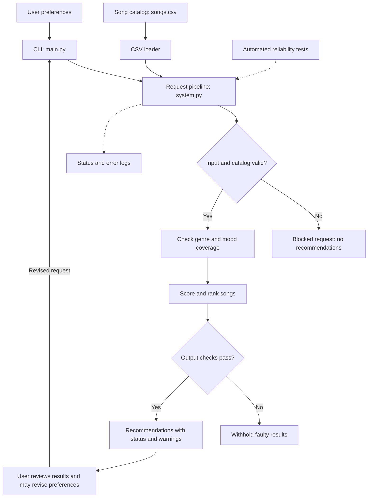

# VibeFinder: Applied AI System

## Summary and Base Project

This project extends my Module 3 Music Recommender Simulation, VibeFinder. The original project scored songs using genre, mood, and energy and returned explained top-five recommendations. It supported three taste profiles and a weight experiment.

Original repository:
https://github.com/Cameron-Batts/ai110-module3show-musicrecommendersimulation-starter

The applied system adds validated requests, catalog checks, coverage warnings, runtime output verification, logging, and automated reliability tests.

## Integrated AI Feature: Reliability System

The selected advanced feature is a reliability and testing system integrated into the main recommendation application.

Every CLI request passes through src/system.py. Invalid preferences or catalog data block recommendations. Unknown genre or mood labels trigger needs_review warnings. Failed output checks withhold results.

The recommender remains a rule-based content-based system. It does not use an LLM, RAG, fine-tuning, or autonomous agent planning.

## Architecture Overview

The CLI loads the CSV and sends requests through validation, coverage checks, scoring, ranking, and output verification. Users can review partial matches and revise their preferences. Logging records request status and errors.

Required Mermaid source: [diagrams/architecture.mmd](diagrams/architecture.mmd)



## Setup

Requires Python 3.10 or newer. Run from the project root. No API key is needed.

```bash
python3 -m venv .venv
source .venv/bin/activate
python -m pip install -r requirements.txt
python -m src.main --demo
```

## Design Decisions and Tradeoffs

The original scoring rule is retained: two points for genre, one for mood, and up to one for energy similarity. Separating scoring from validation keeps the changes understandable and preserves the original behavior for valid inputs.

Verification checks result count, catalog membership, unique IDs, finite and correct scores, descending order, and nonempty explanations. It does not prove that the returned subset is globally optimal or that explanation text accurately describes every contribution.

Unknown categories produce clearly labeled partial matches rather than silently pretending to match. Human review is advisory; no approval gate is enforced.

Logging goes to the terminal rather than a persistent file. Dependencies from the starter are retained, although the runtime application itself uses Python's standard library.

## Reproducible Execution Evidence

The following outputs were captured by executing these commands. Exit code 2 is expected for blocked single requests; successful and needs_review requests return 0.


### Normal pop request

```bash
python -m src.main --genre pop --mood happy --energy 0.8
```
```text
INFO: Request status=ok count=5
Loaded songs: 18

Input: {'genre': 'pop', 'mood': 'happy', 'energy': 0.8}
Status: ok
Technical checks: passed
1. Sunrise City | Score: 3.98
   Because: genre match (+2.00); mood match (+1.00); energy similarity (+0.98)
2. Neon Heartbreak | Score: 2.94
   Because: genre match (+2.00); energy similarity (+0.94)
3. Gym Hero | Score: 2.87
   Because: genre match (+2.00); energy similarity (+0.87)
4. Rooftop Lights | Score: 1.96
   Because: mood match (+1.00); energy similarity (+0.96)
5. Midnight Verse | Score: 0.99
   Because: energy similarity (+0.99)

Exit code: 0
```

### Normal lofi request

```bash
python -m src.main --genre lofi --mood chill --energy 0.35
```
```text
INFO: Request status=ok count=5
Loaded songs: 18

Input: {'genre': 'lofi', 'mood': 'chill', 'energy': 0.35}
Status: ok
Technical checks: passed
1. Library Rain | Score: 4.00
   Because: genre match (+2.00); mood match (+1.00); energy similarity (+1.00)
2. Midnight Coding | Score: 3.93
   Because: genre match (+2.00); mood match (+1.00); energy similarity (+0.93)
3. Focus Flow | Score: 2.95
   Because: genre match (+2.00); energy similarity (+0.95)
4. Spacewalk Thoughts | Score: 1.93
   Because: mood match (+1.00); energy similarity (+0.93)
5. Coffee Shop Stories | Score: 0.98
   Because: energy similarity (+0.98)

Exit code: 0
```

### Unavailable categories

```bash
python -m src.main --genre opera --mood dramatic --energy 0.5
```
```text
INFO: Request status=needs_review count=5
Loaded songs: 18

Input: {'genre': 'opera', 'mood': 'dramatic', 'energy': 0.5}
Status: needs_review
Technical checks: passed
WARNING: No catalog genre matches 'opera'.
WARNING: No catalog mood matches 'dramatic'.
Review these partial matches or revise your preferences.
1. Island Afternoon | Score: 0.98
   Because: energy similarity (+0.98)
2. Porchlight Home | Score: 0.95
   Because: energy similarity (+0.95)
3. Midnight Coding | Score: 0.92
   Because: energy similarity (+0.92)
4. Focus Flow | Score: 0.90
   Because: energy similarity (+0.90)
5. Coffee Shop Stories | Score: 0.87
   Because: energy similarity (+0.87)

Exit code: 0
```

### Invalid energy

```bash
python -m src.main --genre pop --mood happy --energy 1.5
```
```text
WARNING: Request blocked: energy must be a finite number between 0 and 1.
Loaded songs: 18

Input: {'genre': 'pop', 'mood': 'happy', 'energy': 1.5}
Status: blocked
ERROR: energy must be a finite number between 0 and 1.

Exit code: 2
```

## Testing Summary

```bash
python -m pytest -q
```
```text
.........................                                                [100%]
25 passed in 0.06s
```

The suite covers input normalization, invalid energy and k, missing preferences, empty or invalid catalogs, duplicate IDs, normal ranking, coverage warnings, deliberate score corruption, large k, and CLI error handling.

Successful verification means the checked technical conditions passed. It is not a confidence score or evidence of listener satisfaction.

## Limitations

The 18-song catalog is small, genre-heavy scoring can create filter bubbles, and exact label matching ignores related genres. The system validates the fields needed for recommendation rather than every metadata field. Internal scoring functions remain callable without the pipeline; the CLI uses the checked path.

## Reflection

This extension demonstrates the difference between generating a plausible answer and checking that it meets explicit rules. Responsible-AI reflection, collaboration details, and remaining limitations are documented in model_card.md.

## Portfolio

Code: https://github.com/Cameron-Batts/vibefinder-applied-ai

This project demonstrates my approach to extending a prototype with modular validation, explained results, runtime checks, and reproducible testing. It shows how I can document both what a system verifies and what remains uncertain.

## Presentation

[Presentation walkthrough](presentation.md)
